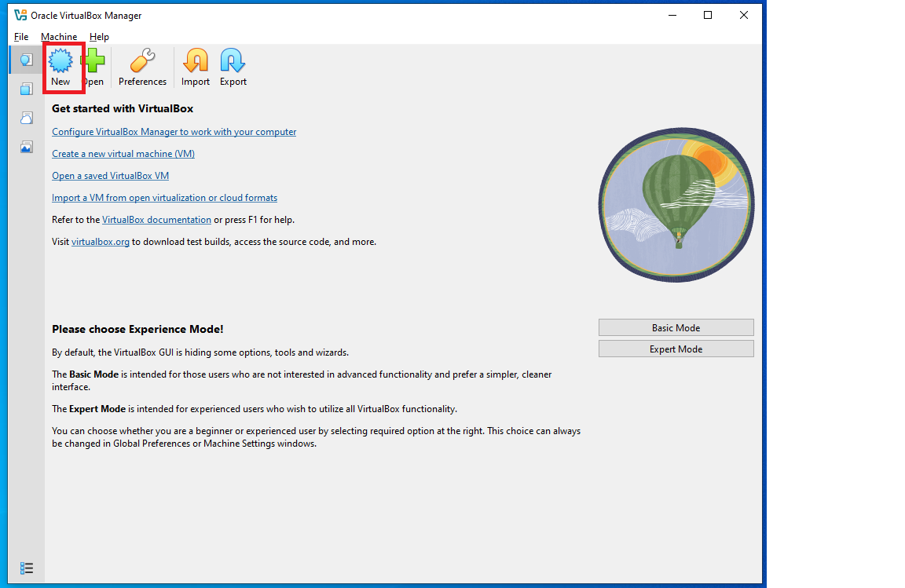

# WindowServer2022Setup
This is an quick installation guide of Window Server 2022 using Window 10 OS.

#Requirement: 

1. Virtual Box->https://www.virtualbox.org/wiki/Downloads
2. Window Server 2022 ISO->https://www.microsoft.com/en-us/evalcenter/download-windows-server-2022

#StepByStep

1.Install the hypervisor Virtual Box onto your PC. Once you install, you should see this screen.
 

2.
