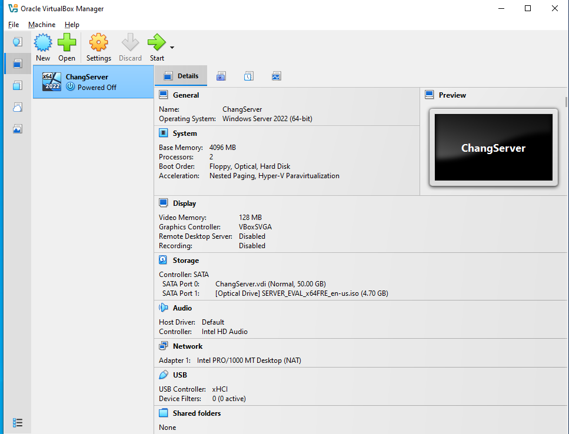

# Windows Server 2022 Setup

This is a quick installation guide for setting up Windows Server 2022 using VirtualBox on a Windows 10 host operating system.

## Requirements

1. [Oracle VirtualBox](https://www.virtualbox.org/wiki/Downloads)
2. [Windows Server 2022 ISO](https://www.microsoft.com/en-us/evalcenter/download-windows-server-2022)

## Step-by-Step Installation Guide

Click on any step below to expand or collapse the installation instructions and screenshots.

<strong>Step 1: Install VirtualBox</strong>

Install the VirtualBox hypervisor onto your PC. Once installed, open VirtualBox Manager. You should see the following screen.

Click the **New** icon to create a virtual machine.

<strong>Step 2: Configure the Virtual Machine</strong>

After clicking **New**, you will see several configuration options.

- **VM Name:** I named mine "ChangServer," but you can choose any name.
- **ISO Image:** Select the Windows Server 2022 ISO downloaded earlier.
- **Unattended Installation:** Uncheck "Proceed with Unattended Installation."

Click **Next** to continue.

<strong>Step 3: Allocate VM Resources</strong>

On this page, we will allocate hardware resources from our host PC to the Windows Server 2022 virtual machine.

Recommended lab configuration:

- **Base Memory (RAM):** 4 GB
- **Processors (CPU):** 2
- **Virtual Hard Disk:** 50 GB

Make sure your host PC has enough available resources before allocating them to the VM.

<strong>Step 4: Start the Virtual Machine</strong>

Once you finish configuring the virtual machine, your VirtualBox Manager should look similar to the screenshot below.

Select your Windows Server 2022 VM and click **Start** to begin the installation.

<strong>Step 5: Select Windows Server Edition</strong>

When you start the new Windows Server 2022 VM, you will be presented with several installation options.

For this tutorial, select:

**Windows Server 2022 Evaluation (Desktop Experience)**

This version provides a graphical user interface (GUI), making it easier to manage Windows Server.

<strong>Step 6: Install Windows Server 2022</strong>

After selecting Windows Server 2022 Evaluation (Desktop Experience), continue through the installation process.

Wait for Windows Setup to copy and install the required operating system files.

<strong>Step 7: Configure Administrator Password</strong>

Once Windows Server 2022 finishes installing, you will be prompted to create a password for the built-in Administrator account.

Create a strong password and complete the initial setup.

<strong>Step 8: Installation Complete!</strong>

Congratulations! You have successfully installed Windows Server 2022 in VirtualBox.

You now have a Windows Server virtual machine that can be used for hands-on IT infrastructure practice.

Possible next steps include:

- Installing Active Directory Domain Services (AD DS).
- Promoting the server to a domain controller.
- Configuring DNS.
- Creating Active Directory users and groups.
- Joining client computers to the domain.

## Acknowledgments and Things to Consider

I want to give a shout-out to Kevtech IT Support. His video installation guide helped me visually learn how to set up a virtual machine using VirtualBox.

This project serves as documentation to help refresh my knowledge whenever I need to revisit the installation process.

One of the key fundamentals I learned is understanding how powerful a hypervisor can be.

For this project, I installed Windows Server 2022 to prepare a virtual environment for practicing Active Directory.

However, hypervisors are not limited to Windows Server or Active Directory. They can also be used to create virtual machines running other operating systems, such as Linux and supported macOS configurations.

This hands-on project helped me gain practical experience with virtualization, virtual machine configuration, resource allocation, and Windows Server installation.
