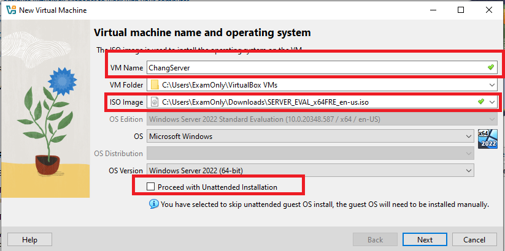
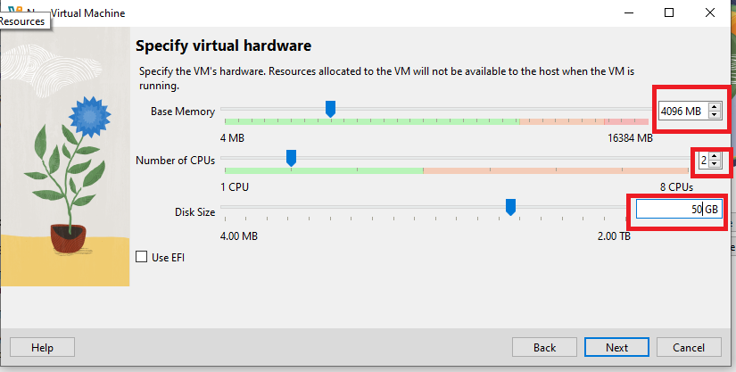
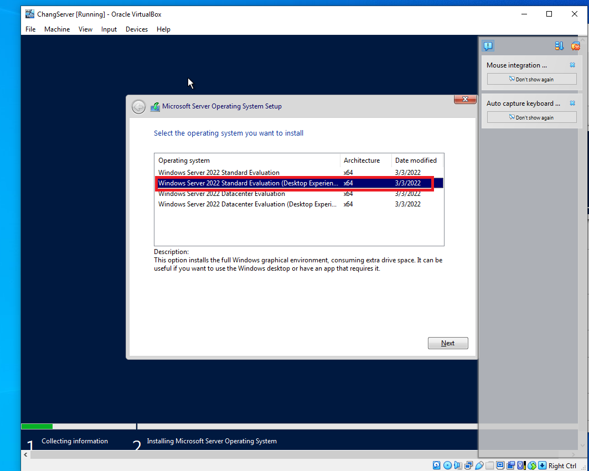
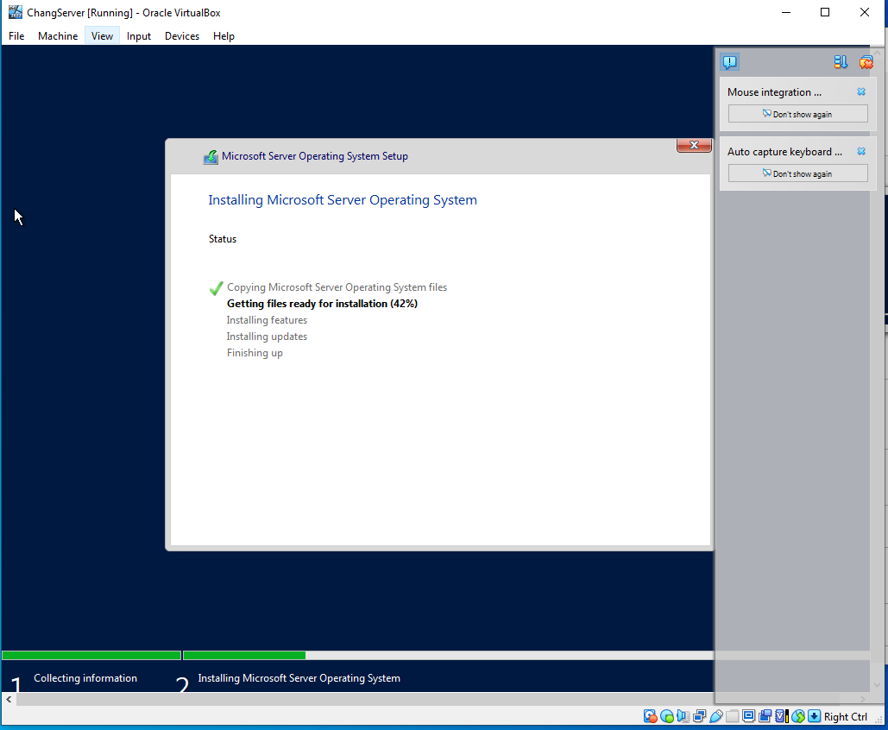
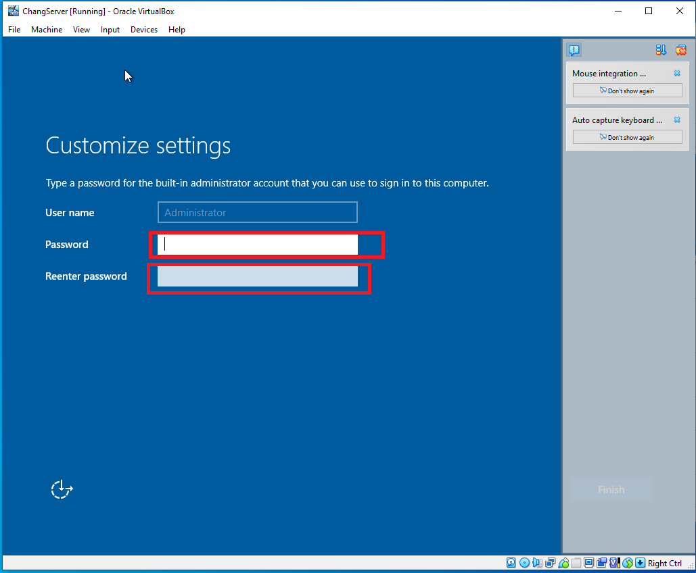
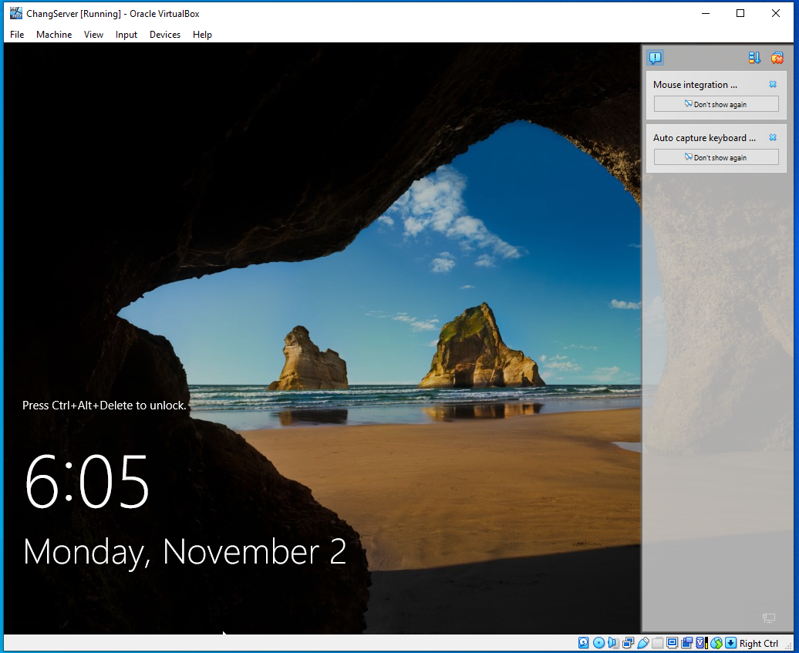

# WindowServer2022Setup
This is an quick installation guide of Window Server 2022 using Window 10 OS.

#Requirement: 

1. Virtual Box->https://www.virtualbox.org/wiki/Downloads
2. Window Server 2022 ISO->https://www.microsoft.com/en-us/evalcenter/download-windows-server-2022

#StepByStep

Step 1: Install the hypervisor Virtual Box onto your PC. Once you install, you should see this screen. Click on the icon "New".
 

Step 2:One you click on "New". These options will be available to customize. For VM Name: I had it ChangServer, you can give any name you want. For the ISO image option, make sure to select the Window Server 2022 ISO, downloaded from above. Finally, uncheck the "Proceed with Unattended Installation", and click "Next" to go to the next page.

Step 3: On this page, we are going to allocate resource from our current PC to the Window Server 2022 VM we are making. It is recommend to allocate "4Gb" of RAM, Base Memory. It is also recommend to allocate 2 CPU. As for size, we are going to allocate 50Gb of storage.

Step 4: Once, you're down with VM allocation. You Virtual Box Manager should look something like this. From here, we should run the Window server 2022 VM we just made.
![img alt]https://github.com/ChangITTech/WindowServer2022Setup/blob/db674e77e5965355f34bda791a320d0c076e376b/image/part4.PNG
Step 5: When you run the fresh Window Server 2022 VM you just made, you should see this follow page. Here we have various option to choose. For this installation we will just "Window Server 2022 Evaluation(Desktop Experience)"

Step 6: After choosing "Window Server 2022 Evaluation(Desktop) Experience". You will land on this page, and wait for it to image the Window Server 2022 ISO to complete.

Step 7: Once it finish installing the repositories, you should land on this page. Here you will, you will make your password for the administrator profile.

Step 8: Congratulation, you have successful made a Window Server 2022 in Virtual Box!

#Acknowledge and things to consider

First, I want to give shout to Kevtech IT support. His video installation guide was how I visually learn how to set up VM through Virtual Box. This is just documentation to help refresh my knowledge, incase i need it.

One of the key fundamental here is understanding how powerful a hypervisor can be.  For this application purpose we just did, it was use to build an Active Directory. But hypervisor is not just limited to creating Active Directory. If needed, I can use an hypervisor on various OS such as macOS and Linux; to create VM with a different OS.
